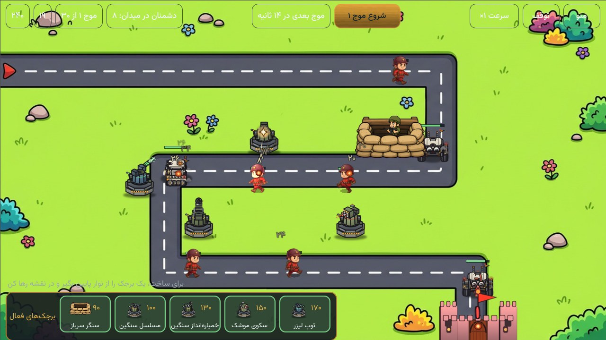
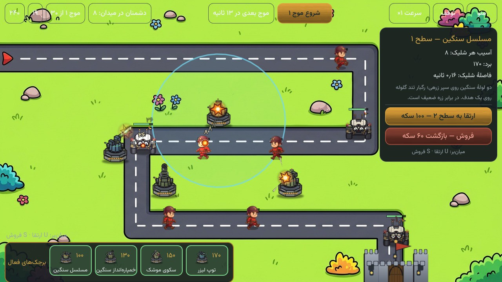

# دژبان (`games/dejban`)

> **وضعیت:** نمونهٔ اولیهٔ ادغام در دورهمی. بازی با همان Godot/GDScript اجرا
> می‌شود و از دکمهٔ «دژبان» در صفحهٔ انتخاب بازی دورهمی باز می‌شود؛ کد بازی به
> کاتلین ترجمه نشده است.

## ساختار

| مسیر | نقش |
|---|---|
| `godot/` | پروژهٔ اصلی Godot 4.3 دژبان: صحنه‌ها، کد GDScript، دارایی‌ها و تست headless |
| `ui/` | ماژول Android Library میزبان: کتابخانهٔ Godot، `DejbanActivity` و لانچر بازی |
| `tools/prepare_android_pack.sh` | ایمپورت، تست headless و ساخت `dezhban.pck` برای بیلد اندروید |
| `godot/tools/gen_fx_sheets.py` | ساخت هشت اسپرایت‌شیت افکت کارتونی (فریم‌های ۶۴×۶۴، ردیف افقی، PNG شفاف) |
| `core/` | جای‌نگهدار قبلی؛ در این ادغام استفاده نمی‌شود، چون منطق بازی داخل Godot است |

## جلوه‌های کارتونی (FX)

هشت شیت افکت در `godot/assets/sprites/fx/` (انفجار کوچک/متوسط/بزرگ، شعلهٔ دهانه، پرتو
لیزر، صاعقهٔ تسلا، ابر دود و شعله) با `godot/tools/gen_fx_sheets.py` ساخته می‌شوند و
با فهرست `Fx.SHEETS` در `godot/src/fx/Fx.gd` به بازی وصل‌اند: `Fx.sheet_frames` هر شیت
افقی را با `AtlasTexture` به فریم‌های ۶۴×۶۴ می‌شکند و `Fx.blast`/`Fx.impact`/`Fx.muzzle`/
`Fx.smoke`/`Fx.flame`/`Fx.beam`/`Fx.bolt` آن را در لحظهٔ شلیک، برخورد گلوله، مرگ دشمن و
زنجیرهٔ صاعقه نشان می‌دهند. تغییر آرایهٔ تصویرها یا افزودن شیت تازه، با اجرای دوبارهٔ
مولد و بعد `godot/tools/gen_assets_manifest.py` در مانیفست دارایی‌ها می‌نشیند؛ تست
headless (`tests/HeadlessTest.gd` → `_test_fx_sheets`) ابعاد و ساخته‌شدن هر شیت را
بررسی می‌کند.

## برجک‌ها و تانک ایزومتریک

دو پک ایزومتریک (`assets/turrets_iso` و `assets/enemy_tank_iso` در ریشهٔ مخزن) بدون
تغییر نام در `godot/assets/sprites/towers_iso/` و `godot/assets/sprites/units/iso_tank/`
کپی شده‌اند و `godot/tools/gen_assets_manifest.py` آن‌ها را با کلیدهای
`towers_iso/<نام>` و `units_iso_tank/<نام>` در `src/data/Assets.gd` می‌نشاند (با تصویر
جایگزین برای هر دو دسته). هر شیت شبکه‌ای از فریم‌های ۱۲۸×۱۲۸ است: ردیف = جهت
(۰=E، ۱=SE، ۲=S، … ساعت‌گرد تا ۷=NE) و ستون = فریم. بارگذار مشترک
`src/data/IsoSheet.gd` فریم‌ها را با `AtlasTexture` (ناحیهٔ `(f*128, dir*128, 128, 128)`)
برش می‌دهد و `dir_from_vector` جهت را با فشردگی عمق ۰٫۵ و باقی‌ماندهٔ مثبت حساب می‌کند؛
اسپرایت‌ها هیچ‌وقت پیوسته نمی‌چرخند و فقط ردیف شیت در گام‌های ۴۵ درجه عوض می‌شود.

**برجک‌ها** (`src/data/Weapons.gd`، `src/game/Tower.gd`): سنگر حذف شده و فقط چهار برجک پک
مانده‌اند؛ مسلسل سنگین برجک رایگانِ آغاز بازی است و خمپاره، موشک و لیزر با ستاره در زرادخانه
باز می‌شوند. پایهٔ ثابت از `IsoSheet.base_texture`
(پیکسل‌های مات مشترک فریم ۰ هر هشت جهت) و سرِ گردان از شیت‌های `idle`/`aim`/`fire` است:
بدون هدف idle، با هدف aim و در هر شلیک یک‌بار fire. شعلهٔ دهانه و گلوله همان سامانهٔ
قبلی‌اند و از دهانهٔ همان جهت (`IsoSheet.TOWER_MUZZLE`) بیرون می‌آیند.

| برجک | سکه | ستاره | آسیب | برد | فاصلهٔ شلیک | نوع |
|---|---:|---:|---:|---:|---:|---|
| مسلسل سنگین (`machinegun`) | ۱۰۰ | ۰ (رایگان) | ۸ | ۱۷۰ | ۰٫۱۶ | تک‌هدف، رگبار |
| خمپاره‌انداز سنگین (`cannon`) | ۱۳۰ | ۵ | ۳۴ | ۲۰۰ | ۱٫۵ | ناحیه‌ای ۵۶، قوی‌ترین هدف |
| سکوی موشک (`rocket`) | ۱۵۰ | ۷ | ۲۴ | ۲۳۵ | ۱٫۲۵ | دو موشک، ناحیه‌ای ۴۴ |
| توپ لیزر (`laser`) | ۱۷۰ | ۹ | ۲۶ | ۱۹۰ | ۰٫۶ | تک‌هدف، زره‌شکاف، قوی‌ترین هدف |

**انتخاب و ارتقا در نبرد و زرادخانه:** کاشت برجک تازه هم‌چنان با گرفتن و کشیدن از نوار پایین
انجام می‌شود، اما برجکِ کاشته‌شده در میدان با **لمس ساده** (و نیز کشیدن) بی‌درنگ انتخاب می‌شود و
پنل سمت راست باز می‌گردد؛ لمس فضای خالیِ بیرون از پنل، انتخاب را می‌بندد و خود پنل لمس را
متوقف می‌کند تا به میدان زیرش نشت نکند. در زرادخانه («اسلحه‌ها») نیز پنجرهٔ جزئیات به صورت
مرکزچین کامل داخل صفحهٔ ۱۲۸۰×۷۲۰ قرار می‌گیرد و آمار مؤثر پس از ارتقا به‌روز نمایش داده می‌شود.
همچنین `DejbanActivity` فایل `dezhban.pck` را بر اساس هش SHA-256 محتوا استخراج می‌کند تا با نصب
دوبارهٔ APK روی نسخهٔ قبلی بدون تغییر `versionCode`، پک قدیمی کش‌شده باقی نماند.

**تانک** (`src/data/Enemies.gd`، `src/game/IsoEnemy.gd`): جان ۴۲۰، سرعت ۲۸، زره ۴،
پاداش ۱۲. از موج ۵ می‌آید و هر ۵ موج یکی بیشتر می‌شود (`1 + (موج − 5) ÷ 5`، موج ۳۰ = ۶
تانک)؛ شمار سربازها تغییری نکرده است. در مسیر با `move` و جهتِ مسیر حرکت می‌کند، ۹۶
پیکسل پیش از دژ می‌ایستد (محاصره)، بین شلیک‌ها `idle` است و هر ۲ ثانیه `attack` را پخش
می‌کند: در فریم لیزر (فریم ۲) پرتو قرمز تا دژ کشیده می‌شود و یک جان کم می‌شود. تا نابود
نشود در فهرست دشمنان می‌ماند، پس هدف برجک‌هاست و موج تمام نمی‌شود.

تست headless (`_test_iso_sheets`، `_test_iso_towers`، `_test_tank` و بخش‌های سلاح، دشمن
و موج) ابعاد هر ۱۷ فایل، برش هشت جهت، حالت‌های برجک و رفتار محاصره را بررسی می‌کند. برای
عکس از نبرد واقعی با برجک‌ها و تانک‌ها (به راه‌انداز گرافیکی نیاز دارد، نه `--headless`):

```bash
godot --path games/dejban/godot --fixed-fps 30 res://tests/iso_battle_shot.tscn -- /tmp/iso_battle.png
```

خروجی همین صحنه روی نقشهٔ ۱. فریم ۰٫۸۷ ثانیه: چهار برجک ایزومتریک در حال شلیک، دو تانک روی
جاده و تانک سوم در محاصرهٔ دژ با پرتو قرمز لیزر؛ نوار ساخت فقط چهار برجک را نشان می‌دهد (سنگر
حذف شده و عرض نوار از اندازهٔ واقعی دکمه‌ها حساب می‌شود).



فریم ۱٫۴۰ ثانیه، با برجک مسلسلِ انتخاب‌شده: پنل برجک زیر نوار بالا باز است و دکمه‌های «ارتقا»
و «فروش» کامل داخل صفحه‌اند.



## منشأ سورس

سورس `godot/` از آخرین نسخهٔ موجود در تاریخچهٔ دورهمی پیش از rollback، یعنی
کامیت `085de98`، بازیابی شده است. ورود اولیهٔ آن در کامیت `9cb440f` از فایل
`Dezhban.zip` انجام شده بود؛ سپس در `15e4990` ست نقشه‌های دست‌ساز ۱۲تایی
جایگزین شد. گردش‌کارهای تو‌در‌توی مخزن مستقل (`godot/.github`) در این نسخه
حفظ نشده‌اند، چون GitHub فقط workflowهای ریشه را اجرا می‌کند و معادل ریشه‌ای
آن‌ها اینجاست.

## روش اجرا در اندروید

1. اسکریپت آماده‌سازی با Godot 4.3 پروژه را import می‌کند، تست headless را
   اجرا می‌کند و خروجی `godot/build/dezhban.pck` را می‌سازد.
2. ماژول `:games:dejban:ui` آن PCK را به‌صورت asset در کتابخانه قرار می‌دهد.
3. `DejbanActivity` در اولین اجرا PCK را از assets به حافظهٔ داخلی اپ کپی
   می‌کند (موتور روی اندروید مسیر نسبیِ asset را باز نمی‌کند) و با کتابخانهٔ
   رسمی Godot Android و آرگومان `--main-pack <مسیر مطلق فایل کپی‌شده>` بازی
   را اجرا می‌کند. برای کوچک ماندن APK، اپ فقط ABI ‏`arm64-v8a` را نگه
   می‌دارد و کتابخانه‌های نیتیو داخل APK فشرده می‌شوند.
4. Activity در پردازش جدا (`:dejban`) و به‌صورت landscape اجرا می‌شود تا
   چرخهٔ حیات و خطاهای نیتیو موتور، پردازش اصلی Compose را پایین نیاورد.
5. خروج داخل بازی (`get_tree().quit()`) پردازش `:dejban` را می‌بندد و کاربر
   به فهرست بازی‌های دورهمی برمی‌گردد. موتور Godot در هر پردازش فقط یک بار
   راه‌اندازی می‌شود، پس شروع بعدی بازی همیشه با یک پردازش و موتور تازه است.

فایل PCK تولیدی commit نمی‌شود؛ در CI پیش از Gradle ساخته می‌شود. ذخیرهٔ
دژبان همچنان با `user://dezhban_save.json` داخل داده‌های اپ دورهمی انجام
می‌شود و ذخیرهٔ نسخهٔ مستقل قدیمی به‌صورت خودکار منتقل نمی‌شود.

## اجرا و بررسی محلی

```bash
# ساخت PCK (در لینوکس، Godot 4.3 و templateها را در صورت نیاز دانلود می‌کند)
bash games/dejban/tools/prepare_android_pack.sh

# ساخت اپ
./gradlew :app:assembleDebug

# اجرای مستقیم پروژه در ویرایشگر Godot
godot --path games/dejban/godot

# فقط تست بدون رابط دژبان
godot --headless --path games/dejban/godot --import
godot --headless --path games/dejban/godot res://tests/headless_test.tscn
```

## CI

- `Dejban (Godot) verify`: هنگام تغییر پروژهٔ Godot، import و تست headless.
- `CI`: پیش از `checkAll` و ساخت APK، PCK را با همان اسکریپت آماده‌سازی
  تولید می‌کند.
- `Debug APK`: پیش از ساخت APK دیباگ، PCK را تولید می‌کند.

این بازی فعلاً یک تجربهٔ محلی مستقل است و در `GameRegistry` یا سرور دورهمی
ثبت نمی‌شود؛ لابی، اتاق و قابلیت‌های آنلاین دورهمی به آن وصل نیستند.
